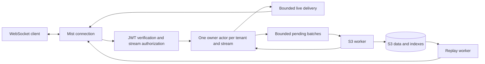

# Highway architecture

Highway provides ordered, authorized streams over WebSockets, with immediate live delivery and asynchronous S3 history. The authenticated live path, S3 archival/recovery, and authorized replay/live join (milestones 1–5) are implemented. Memory mode remains an explicit ephemeral adapter.

## Implemented local slice

Both modes bind loopback and preserve accepted-before-durable semantics. Memory never emits `persisted`, keeps readiness at 503, and creates a new incarnation per owner. S3 workers allocate durable epochs, write immutable batches/indexes, and advance progress only after conditional authoritative head publication. A registry serializes owner startup; owners do not perform network I/O. Per-actor admission permits, pending byte/record/age accounting, socket credit, and a 16-operation storage cap bound outstanding work.

Every S3 restart writes a conservative interrupted-epoch index boundary before new admission. Confirmed commits release pending capacity; a bounded last-batch cache serves current live readers. Readers behind the cache fetch committed records through bounded replay workers. Earliest/after history reads join that archive with the pending suffix and later live events; latest readers retain an exclusive access floor. Missing data never means a successful end of replay.

See [Decision 001](decisions/001-development-live.md) for the original memory slice and [Decision 002](decisions/002-s3-archival.md) for storage format v1, transport, reconciliation, and bounds. [Decision 003](decisions/003-replay-continuation.md) documents the implemented reader and handoff. S3 behavior is locally verified through deterministic failpoints and a real-adapter contract fixture; AWS conformance remains an explicit pre-release check.

## Delivery contract

| Property | Version one behavior |
| --- | --- |
| Ordering | Total order within a stream, assigned by one owner actor; no cross-stream ordering |
| Live acceptance | `accepted` means admitted to bounded memory and assigned a cursor; subscribers may receive the event immediately |
| Durability | `persisted` means both data and its authoritative index are committed in S3 |
| Failure | An owner or node crash can lose accepted records after the persisted cursor |
| Reconnect | Replay from an exclusive cursor, then follow live on the same subscription |
| Replay gaps | An explicit discontinuity describes an uncertain tail after an interrupted epoch |
| Retries | May duplicate across restart; client message IDs support application reconciliation |
| Storage | S3 holds all authoritative durable state; memory is a live buffer and cache |

This deliberately differs from S2 Lite, which documents durability before acknowledgments and reads. Highway prioritizes the requested live latency. Any future durable-before-live mode must be a separate, explicit contract.

## Process model



Use Gleam on Erlang/OTP with Mist, `gleam_otp`, `gleam_erlang`, and typed JSON codecs. A supervisor starts configuration, key verification, a stream registry and supervised owners, replay/storage workers, and the listener. Each connection holds authentication, subscriptions, and credit. The registry keys owners by `(tenant, stream)` and prevents duplicate local startup.

A stream owner serializes publishing, allocates cursors, records subscriptions, and advances persistence state. It must not block on S3 requests or socket writes. Storage workers return completion messages carrying epoch and batch identity; reject stale completions. Use credit and bounded outstanding requests between processes: BEAM mailboxes do not become bounded just because an application list has a maximum length.

Start owners on demand. Evict an idle owner only after pending batches drain and its epoch is cleanly closed. If an owner fails, terminate its dependent writers and subscriptions, mark the interruption on recovery, and force reconnect. Do not keep a subscription attached to a silently replaced owner.

## Cursor and epoch design

A cursor identifies `(stream incarnation, owner epoch, offset)`. The stream is already identified by the request; cursors remain bound to it when decoded. The canonical wire format is the opaque versioned cursor documented in the protocol. Decimal counters travel as strings, so JavaScript cannot round large integers.

The incarnation is fixed for the lifetime of a stream. Deletion and recreation are outside version one. On every owner startup, durably allocate an increasing epoch in the stream head using a conditional S3 update **before accepting publishes**. Then assign offsets from one in memory. Startup pays one metadata round trip; ordinary live publishes do not wait for S3. Never restart offsets inside the same epoch after losing owner state.

Example: an owner broadcasts offsets 1 through 15 in epoch 7 but archives only through 10 before crashing. Recovery starts epoch 8. History retains epoch 7 offsets 1 through 10, followed by an interruption boundary, then epoch 8. A client holding epoch 7 offset 15 receives the boundary and can continue into epoch 8. It must not silently stall waiting for offset 16.

Since the unpersisted highest offset was in memory, recovery cannot know the exact lost range or count. Record `after = last archived cursor`, `before_epoch = new epoch`, and `reason = interrupted_epoch`; describe the missing tail as potentially lost. Even a restart with no actual loss can conservatively report this boundary. Graceful closure can record the exact final offset.

On recovery, write the prior epoch boundary into an immutable index page and publish that index root together with the new epoch in the conditional head update. New live admission begins only after this update succeeds, so another crash cannot erase the boundary between epochs.

## Live publish and archival

1. Validate authentication, exact tenant and stream grant, payload size, and capacity.
2. The owner allocates a cursor, retains the full event in its pending buffer, and schedules live delivery.
3. Send the publisher `accepted`. This does not promise receipt by other clients or durability.
4. Flush a batch when its byte limit or timer fires. Keep just one committing batch per stream initially, preserving a contiguous persisted prefix within an epoch.
5. Upload an immutable segment with `If-None-Match: *`, using a versioned JSON event envelope; its index entry carries cursor bounds, count, and the segment SHA256.
6. Upload an immutable index page referencing the segment and prior index state.
7. Conditionally replace `head.json` with `If-Match` on its prior ETag, advancing the index root and archived cursor. The update must still refer to the active epoch.
8. Only after the head commit, emit cumulative `persisted` progress and release pending memory. Publishers may reconnect before receiving this notice; history remains authoritative.

The implemented starting values flush at the next 250 ms timer or 1 MiB, with maximum pending age, record-count, and byte limits. These are unbenchmarked limits, not latency promises. Low-volume streams need a timer; waiting for a large segment indefinitely is unacceptable.

## S3 layout and commit rules

```text
<prefix>/v1/tenants/<tenant-id>/streams/<stream-id>/
  head.json
  segments/<epoch>/<batch-id>.json
  indexes/<index-id>.json
```

Tenant/stream IDs are lowercase hexadecimal encodings of their UTF-8 bytes, not raw user-controlled path fragments. Use a private bucket and server-side credentials. JWTs grant application access, never direct bucket permissions.

The head contains format version, incarnation, current epoch, epoch status, index root, and archived cursor. Immutable index pages contain bounded segment entries and epoch boundary entries. Each entry includes cursor bounds, checksum, and object key. Begin with bounded linked pages; acknowledge that distant backward traversal is linear in page count. Add checkpoint or range indexes when measured replay costs justify them. Never let one manifest grow with the full stream lifetime.

The head is the sole publication point. S3 does not provide a transaction covering all these objects. Uploaded segments and indexes that are unreachable from the committed head are orphans, not history. A `persisted` notice requires the head to reference the complete data path.

Use AWS S3's documented strong read-after-write behavior and conditional writes. Treat ETags as opaque version tokens, not content checksums. A timeout is ambiguous: read and reconcile the head and batch identity before retrying. A failed precondition means reconcile state or stop; never overwrite unconditionally. Do not use bucket listing or S3 notifications as the record commit order.

Development object stores must pass conformance checks for conditional requests, metadata, and read visibility. S3-compatible branding alone is insufficient. Version one targets AWS S3 general purpose buckets; directory buckets and other providers need explicit validation.

## Replay and live handoff (implemented milestone 5)

A subscribe command enters the owner mailbox. In one serialized operation the owner registers the subscriber and captures a live high watermark H. A replay worker then reads `(requested cursor, H]` from the immutable archive plus a bounded retained memory suffix. Events accepted after H belong to live follow.

Retain pending events until the archive commits. If persistence moves a boundary while a replay worker fetches it, retry against the new archive state; do not interpret cache eviction as end of stream. Workers pin an authoritative immutable index root for a bounded step; a fresh seek rechecks the head after cache eviction. No history copy is retained per subscriber.

A connection tracks its last sent cursor and receives records in order, filtering overlap at the boundary. The 20 ms socket tick pulls a bounded batch rather than queuing payload notifications. A slow subscriber pauses on credit, fetches persisted backlog later, or receives `slow_consumer` and reconnects. A memory/replay cap cannot cause silent event skipping.

`caught_up` means the subscription has reached H. It does not mean all delivered events are archived. A finite replay completes at H even if later events have been accepted; follow emits post-H events only after the caught-up notice. Persistence progress is separate. Persisted history can be replayed again; clients reconcile by cursor. Live events lost in a crash cannot be promised at-least-once replay.

A latest-only subscriber without the history grant can receive records accepted after its captured start watermark for the lifetime of that subscription, including internal reads from S3 if those records have since been archived. It cannot read records at or before that watermark or resume after the subscription closes. This prevents storage movement from changing authorization while preserving the distinction between live access and scrollback.

Replay scans traverse reverse-linked index pages with strictly decreasing cursor/epoch bounds, validate segment checksums and contiguous records, and retain one candidate entry rather than a whole manifest. Reads are authorized before and after each object fetch. A logical epoch-zero boundary orders interrupted epochs even when their last archived cursor repeats or precedes the resume cursor. The socket verifies every next record is exactly the next offset or an explicit next-epoch boundary. Unknown gaps fail explicitly.

Temporary supervised replay jobs are limited to one per connection and eight per node by default, with bounded pages per turn, total pages per scan, bytes, and elapsed replay time. Result reservations and encoded buffered items share the connection output budget. A small guardian monitors the connection and owner and cancels blocked I/O if either dies. Refresh cancels jobs and invalidates result generations before retaining replacement capabilities. Index traversal is linear per seek and repeated seeks can be expensive; checkpoint indexes and production sizing remain future work.

## Authentication

The application backend is the token issuer. Start with one configured issuer and audience, a locally configured verification key set keyed by `kid`, and one explicitly configured asymmetric signing algorithm, preferably EdDSA after library validation. JOSE 1.11.12 and a small typed Erlang binding implement strict EdDSA verification in this slice. No custom cryptographic implementation.

Require a valid signature, issuer, audience, subject, expiry, issued-at policy, and tenant. Validate `nbf` when present, enforce maximum token age/lifetime and bounded clock skew, reject `none`, algorithm confusion, and unknown keys. Token input cannot select a remote key URL. Exact stream grants separately authorize `publish`, `subscribe`, and `history`; live access does not implicitly grant old history.

Authenticate with the first WebSocket frame to support browsers. Unauthenticated connections have a short deadline and no stream access. Authorize every operation and history fetch, and enforce expiry during an existing subscription. Refresh replaces capabilities; immediately cancel any subscriptions no longer allowed. Version one uses short-lived tokens and has no immediate revocation service. Origin checks, TLS, rate limits, and logs that redact tokens are required before exposure.

## Capacity and operational behavior

Bound total pending bytes and age, pending bytes per stream, active streams, socket output bytes, subscriptions, frames, in-flight publishes, replay workers, and S3 concurrency. Initial limits belong in the protocol and configuration. Stop accepting before buffers fill. Already accepted events stay queued for archival; rejecting future work does not undo live delivery.

During an S3 outage, serve existing authorized live streams only within the configured pending limits. Then reject new publishes with `storage_backlog`; never discard accepted records to make room. New owners cannot allocate epochs while S3 is unavailable. Readiness degrades when persistence cannot make progress or capacity is exhausted; liveness reflects process health.

Planned milestone 6 shutdown stops admission, drains pending data with a deadline, records clean epoch closures when possible, then closes sockets. Current shutdown/crash recovery conservatively treats every prior epoch as interrupted. If draining fails, close with a retryable reason and leave the epoch interrupted. Monitor accepted-to-persisted lag, oldest pending age, pending bytes, S3 errors, replay latency, dropped connections, and actor mailbox length. Avoid raw stream names as unbounded metric labels.

## Deployment and future work

Version one runs exactly one BEAM node against a storage prefix. Use stop-then-start deployment; overlapping rolling updates are unsupported. S3 head preconditions detect conflicting persistence, but do not fence a stale process from sending live events. They are not a distributed lease. Automatic takeover requires an ownership design that fences both live and storage paths.

Defer clustering, multi-region writes, consumer groups, server-stored consumer offsets, arbitrary filtering, search, compaction, retention deletion, and S2 API compatibility. Initial history is append-only with no automatic deletion. Never enable lifecycle deletion for referenced segments without retention metadata and replay semantics.

S3 request counts scale with active streams and flush frequency. A full batch normally writes a segment, index, and head; many quiet streams can create many small objects. Measure this before promising costs or throughput. Cross-stream archival batching could reduce requests later but introduces a more complex commit/index design.

## Sources

- [S2 README and Lite design](https://github.com/s2-streamstore/s2): stream ownership and its stronger durability contract.
- [Mist](https://hexdocs.pm/mist/): HTTP and WebSocket transport.
- [Gleam OTP](https://hexdocs.pm/gleam_otp/): typed OTP integration.
- [AWS S3 consistency](https://docs.aws.amazon.com/AmazonS3/latest/userguide/Welcome.html#ConsistencyModel): read-after-write behavior.
- [AWS conditional writes](https://docs.aws.amazon.com/AmazonS3/latest/userguide/conditional-writes.html): object creation and ETag-based conditional updates.
